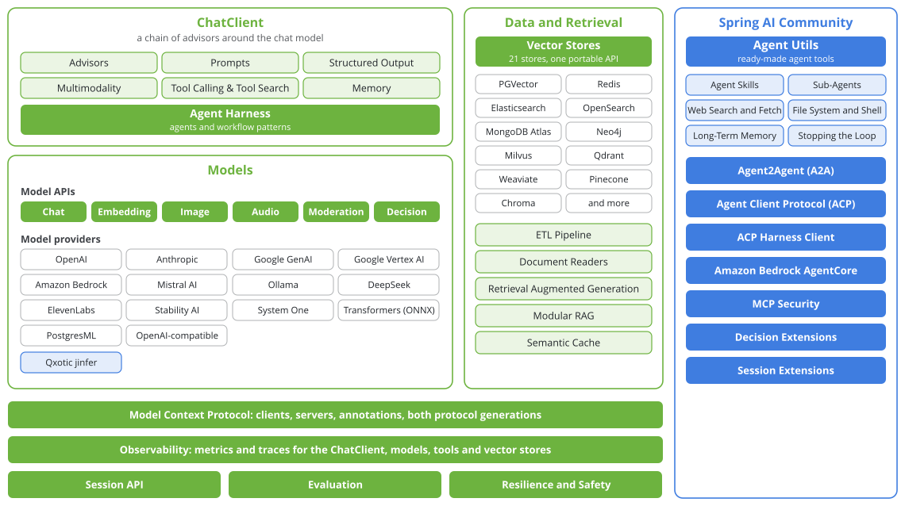

# Spring AI [](https://github.com/spring-projects/spring-ai/actions/workflows/build-and-deploy-snapshot.yml) [](https://central.sonatype.com/artifact/org.springframework.ai/spring-ai-model)

The Spring AI project provides a Spring-friendly API and abstractions for developing AI applications.

Its goal is to apply Spring ecosystem design principles, such as portability and modular design, to the AI domain and promote using strongly-typed data structures and APIs as the building blocks of an application.

At its core, Spring AI addresses the fundamental challenge of AI integration: connecting your enterprise __Data__ and __APIs__ with the __AI Models__.

<picture>
  <source media="(prefers-color-scheme: dark)" srcset="spring-ai-docs/src/main/antora/modules/ROOT/images/spring-ai-project-map-dark.svg">
  
</picture>

## Getting Started

Create a project on [start.spring.io](https://start.spring.io/) with the *Spring Web* and *OpenAI* dependencies, set the `spring.ai.openai.api-key` property, and inject the auto-configured `ChatClient.Builder`:

```java
@RestController
class ChatController {

    private final ChatClient chatClient;

    ChatController(ChatClient.Builder chatClientBuilder) {
        this.chatClient = chatClientBuilder.build();
    }

    @GetMapping("/ai")
    String ask(@RequestParam(defaultValue = "Tell me a joke") String message) {
        return this.chatClient.prompt()
            .user(message)
            .call()
            .content();
    }

}
```

The [Quickstart](https://docs.spring.io/spring-ai/reference/2.1-SNAPSHOT/get-started/quickstart.html) explains each step and runs the same code against a local model.
From there, continue with:

* [Project Setup](https://docs.spring.io/spring-ai/reference/2.1-SNAPSHOT/get-started/project-setup.html) - the BOM, the starters and the repositories.
* [Choosing a Model Provider](https://docs.spring.io/spring-ai/reference/2.1-SNAPSHOT/get-started/choose-provider.html) - what each provider supports.
* The tutorials: [Chat with Your Documents](https://docs.spring.io/spring-ai/reference/2.1-SNAPSHOT/tutorials/rag.html), [Give the Model Tools](https://docs.spring.io/spring-ai/reference/2.1-SNAPSHOT/tutorials/tools.html), [A Conversational App with Sessions](https://docs.spring.io/spring-ai/reference/2.1-SNAPSHOT/tutorials/sessions.html) and [Build and Use an MCP Server](https://docs.spring.io/spring-ai/reference/2.1-SNAPSHOT/tutorials/mcp.html).

Spring Boot version compatibility:

| Spring AI | Branch | Spring Boot |
|-----------|--------|-------------|
| 2.1.x | [main](https://github.com/spring-projects/spring-ai/tree/main) | 4.2.x |
| 2.0.x | [2.0.x](https://github.com/spring-projects/spring-ai/tree/2.0.x) | 4.1.x |
| 1.1.x | [1.1.x](https://github.com/spring-projects/spring-ai/tree/1.1.x) | 3.5.x |

## Features

This is a high level feature overview.
The [reference documentation](https://docs.spring.io/spring-ai/reference/2.1-SNAPSHOT/) follows the same structure.

### ChatClient

* [ChatClient](https://docs.spring.io/spring-ai/reference/2.1-SNAPSHOT/chatclient/index.html) - Fluent API for communicating with AI chat models, with synchronous and streaming calls, idiomatically similar to the WebClient and RestClient APIs.
* [Advisors](https://docs.spring.io/spring-ai/reference/2.1-SNAPSHOT/advisors/index.html) - Encapsulate recurring generative AI patterns, transform the data sent to and from the model, and provide portability across models and use cases.
* [Prompts and Templates](https://docs.spring.io/spring-ai/reference/2.1-SNAPSHOT/prompts/index.html) - Messages, prompt templates and prompt engineering patterns.
* [Structured Output](https://docs.spring.io/spring-ai/reference/2.1-SNAPSHOT/structured-output/index.html) - Mapping of AI model output to POJOs.
* [Multimodality](https://docs.spring.io/spring-ai/reference/2.1-SNAPSHOT/multimodality.html) - Images, audio and other media next to text in a message.
* [Tool Calling](https://docs.spring.io/spring-ai/reference/2.1-SNAPSHOT/tools/index.html) - Permits the model to request the execution of client-side tools and functions, with [Tool Search](https://docs.spring.io/spring-ai/reference/2.1-SNAPSHOT/tools/tool-search.html) for large tool sets and [Tool Call Confirmation](https://docs.spring.io/spring-ai/reference/2.1-SNAPSHOT/tools/confirmation.html) to let a person approve a call.
* [Memory](https://docs.spring.io/spring-ai/reference/2.1-SNAPSHOT/memory/index.html) - The [Session API](https://docs.spring.io/spring-ai/reference/2.1-SNAPSHOT/memory/session/index.html) keeps a conversation as an append-only log of events, with turn-aware compaction, recall and a JDBC repository.
* [Agents](https://docs.spring.io/spring-ai/reference/2.1-SNAPSHOT/agents/index.html) - The advisor chain of a `ChatClient` and its tools form the agent harness, with examples of the common workflow patterns.

### Models

* Portable [Model APIs](https://docs.spring.io/spring-ai/reference/2.1-SNAPSHOT/models/index.html) across AI providers:
  - [Chat](https://docs.spring.io/spring-ai/reference/2.1-SNAPSHOT/models/chat.html)
  - [Embedding](https://docs.spring.io/spring-ai/reference/2.1-SNAPSHOT/models/embeddings.html)
  - [Image](https://docs.spring.io/spring-ai/reference/2.1-SNAPSHOT/models/image.html)
  - [Text to Speech](https://docs.spring.io/spring-ai/reference/2.1-SNAPSHOT/models/audio/speech.html) and [Audio Transcription](https://docs.spring.io/spring-ai/reference/2.1-SNAPSHOT/models/audio/transcription.html)
  - [Moderation](https://docs.spring.io/spring-ai/reference/2.1-SNAPSHOT/models/moderation.html)
  - [Decision](https://docs.spring.io/spring-ai/reference/2.1-SNAPSHOT/models/decision.html)
* Support for all major [AI Model providers](https://docs.spring.io/spring-ai/reference/2.1-SNAPSHOT/integrations/models/index.html) such as Anthropic, OpenAI, Amazon Bedrock, Google, Ollama, Mistral AI, DeepSeek, and more.
  Access to [model-specific features](https://docs.spring.io/spring-ai/reference/2.1-SNAPSHOT/models/chat.html#_chat_options) is also available.

### Data and Retrieval

* Support for all major [Vector Store providers](https://docs.spring.io/spring-ai/reference/2.1-SNAPSHOT/integrations/vector-stores/index.html) such as *Amazon Bedrock Knowledge Base, Amazon S3, Apache Cassandra, Azure Vector Search, Chroma, Couchbase, Elasticsearch, GemFire, MariaDB, Milvus, MongoDB Atlas, Neo4j, OpenSearch, Oracle, Oracle Coherence, PostgreSQL/PGVector, Pinecone, Qdrant, Redis, Typesense, and Weaviate*.
* Portable [Vector Store API](https://docs.spring.io/spring-ai/reference/2.1-SNAPSHOT/rag/vector-store/index.html) across providers, including a novel SQL-like [metadata filter API](https://docs.spring.io/spring-ai/reference/2.1-SNAPSHOT/rag/vector-store/filters.html).
* Document ingestion [ETL framework](https://docs.spring.io/spring-ai/reference/2.1-SNAPSHOT/rag/etl/index.html) for Data Engineering, with [document readers](https://docs.spring.io/spring-ai/reference/2.1-SNAPSHOT/integrations/document-readers/index.html) for PDF, Markdown, HTML, Office formats and more.
* [Retrieval Augmented Generation (RAG)](https://docs.spring.io/spring-ai/reference/2.1-SNAPSHOT/rag/index.html) - Out-of-the-box RAG flows as advisors, and a modular architecture to build your own.
* [Semantic Caching](https://docs.spring.io/spring-ai/reference/2.1-SNAPSHOT/rag/semantic-cache.html) - Returns a cached response to a semantically similar request.

### Model Context Protocol

* [MCP (Model Context Protocol)](https://docs.spring.io/spring-ai/reference/2.1-SNAPSHOT/mcp/index.html) - First-class support via Boot Starters and MCP Java Annotations for building AI applications that consume MCP servers or expose Spring-based services to the AI ecosystem, for both the modern and the legacy generation of the protocol.

### Across the Application

* [Observability](https://docs.spring.io/spring-ai/reference/2.1-SNAPSHOT/observability/index.html) - Metrics and traces for the `ChatClient`, advisors, models, tool calls and vector stores.
* [Evaluation and Testing](https://docs.spring.io/spring-ai/reference/2.1-SNAPSHOT/evaluation/index.html) - Utilities to help evaluate generated content and protect against hallucinated responses, with Testcontainers and Docker Compose support.
* [Resilience and Safety](https://docs.spring.io/spring-ai/reference/2.1-SNAPSHOT/resilience/index.html) - Retry of failed model calls, and guardrails for unwanted content.
* Spring Boot Auto Configuration and [Starters](https://docs.spring.io/spring-ai/reference/2.1-SNAPSHOT/reference/modules.html) for all AI Models and Vector Stores - use [start.spring.io](https://start.spring.io/) to select the Model or Vector Store of choice.

### Community

* [Community-maintained projects](https://docs.spring.io/spring-ai/reference/2.1-SNAPSHOT/integrations/community/index.html) add agent tools, MCP security, agent protocols and more model and vector store integrations.
  They follow their own release schedule and support terms, which that page describes.

## Project Resources

* [Reference documentation](https://docs.spring.io/spring-ai/reference/)
* [Javadoc](https://docs.spring.io/spring-ai/docs/current/api/)
* [Upgrade notes](https://docs.spring.io/spring-ai/reference/2.1-SNAPSHOT/upgrading/index.html)
* [Modules and Starters](https://docs.spring.io/spring-ai/reference/2.1-SNAPSHOT/reference/modules.html) - Every artifact, with its auto-configuration and starter.
* [Samples and Workshops](https://docs.spring.io/spring-ai/reference/2.1-SNAPSHOT/resources/samples.html)
* [Spring AI Examples](https://github.com/spring-projects/spring-ai-examples) - Contains example projects that explain specific features in more detail.
* [Awesome Spring AI](https://github.com/spring-ai-community/awesome-spring-ai) - A curated list of awesome resources, tools, tutorials, and projects for building generative AI applications using Spring AI
* [Spring AI Community](https://github.com/spring-ai-community) - A community-driven organization for building Spring-based integrations with AI models, agents, vector databases, and more.

## Building from source

You don’t need to build from source to use Spring AI.
If you want to try out the latest and greatest, Spring AI can be built and published to your local Maven repository:
```shell
./mvnw clean install
```
This command builds all modules, runs unit tests, and publishes artifacts to your local Maven repository.

Please read our [contribution guidelines](CONTRIBUTING.md) for more details.

## Contributing

We welcome contributions of all kinds!
Please read our [contribution guidelines](CONTRIBUTING.md) before submitting a pull request or an issue.
